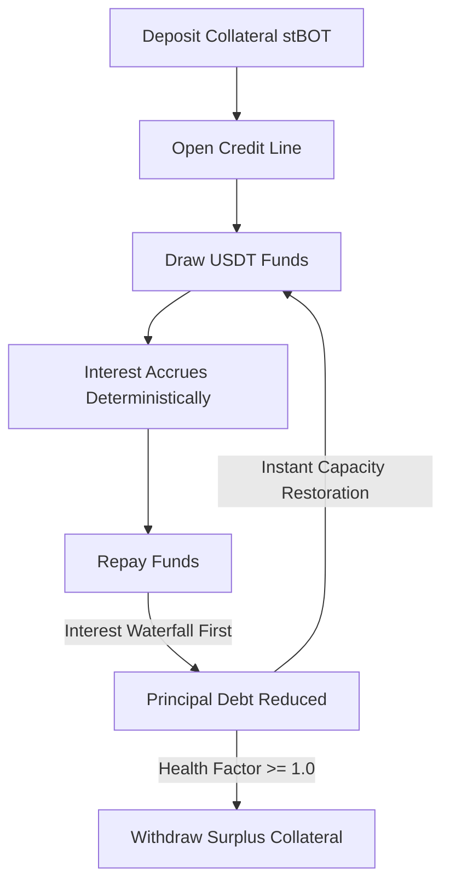

# CreditRail — Protocol Architecture & Technical Specification

## 1. System Vision & The Revolving Credit Primitive
CreditRail is an on-chain revolving credit facility engineered specifically for approved, overcollateralized participants on **BOT Chain Mainnet**.

Unlike conventional DeFi money markets (Compound, Aave) that pool unbounded lenders and borrowers into floating-rate algorithmic pools, or term lending protocols where positions must be fully closed and reopened with new loan terms, **CreditRail functions as a continuous revolving facility**:
- **Continuous Credit Capacity**: Repaying borrowed principal instantly restores available credit line capacity.
- **Single Position Lifecycle**: Borrowers do not need to burn tokens, close credit lines, or redeem collateral just to adjust their leverage.
- **Predictable Fixed Pricing**: Origination fees (0.50%) and fixed annual borrowing rates (8.00% APR) eliminate rate volatility.



---

## 2. Core Protocol Lifecycle

### Phase 1: Collateralization & Activation
1. **Collateral Deposit**: The borrower deposits approved collateral (`stBOT`, 18 decimals) into the vault using `depositCollateral(amount)`.
2. **Line Opening**: The borrower invokes `openCreditLine()` which verifies non-zero collateral and initializes the accounting clock.

### Phase 2: Drawing Liquidity
1. **Capacity Evaluation**:
   $$\text{Collateral Value (USDT)} = \frac{\text{Collateral Amount} \times \text{Price} \times 10^{\text{borrowDec}}}{10^{\text{colDec}} \times 10^{\text{oracleDec}}}$$
   $$\text{Max Borrow} = \frac{\text{Collateral Value} \times \text{MaxLTVBps}}{10000}$$
2. **Origination Fee**:
   $$\text{Fee} = \frac{\text{Draw Amount} \times \text{OriginationFeeBps}}{10000}$$
3. **Execution**: The borrower receives $\text{Draw Amount} - \text{Fee}$. The vault retains the fee as protocol revenue and increments `principalDebt`.

### Phase 3: Interest Accrual & Repayment Waterfall
1. **Deterministic Time-Based Interest**:
   $$\Delta \text{Interest} = \frac{\text{PrincipalDebt} \times \text{BorrowRateBps} \times \Delta t}{10000 \times 31,536,000}$$
2. **Strict Waterfall Priority**:
   When a borrower executes `repay(amount)`:
   - **Step 1**: All accrued and pending interest is paid off first:
     $$\text{Interest Paid} = \min(\text{Amount}, \text{Total Interest})$$
   - **Step 2**: Any remaining payment directly reduces `principalDebt`:
     $$\text{Principal Paid} = \min(\text{Amount} - \text{Interest Paid}, \text{Principal Debt})$$
3. **Capacity Restoration**: The reduction in `principalDebt` immediately expands `availableCredit = MaxBorrow - NewTotalDebt` without any secondary approval.

### Phase 4: Redraw & Revolving Access
At any time, while the position remains healthy, the borrower can invoke `redraw(amount)` to draw up to the refreshed `availableCredit`.

### Phase 5: Collateral Withdrawal
When withdrawing collateral via `withdrawCollateral(amount)`, the protocol simulates post-withdrawal health:
$$\text{Health Factor} = \frac{(\text{Remaining Collateral Value}) \times \text{LiquidationThresholdBps}}{\text{Total Debt} \times 10000}$$
If $\text{Health Factor} < 1.0$, the call reverts with `InsufficientCollateralForWithdrawal()`.

---

## 3. Storage Layout & Packing Optimization

To minimize transaction overhead, `CreditRailVault.sol` packs the borrower's state into **two 32-byte storage slots**:

```
Slot 0: [ depositedCollateral (uint128: 16B) | principalDebt (uint128: 16B) ] = 32 Bytes
Slot 1: [ accruedInterest (uint128: 16B) | lastAccrualTimestamp (uint40: 5B) | isActive (bool: 1B) | (10B unused) ] = 22 Bytes
```

### Benefits:
- Single SLOAD reads both collateral and principal debt.
- Single SLOAD reads accrued interest, timestamp, and activation status.
- Single SSTORE updates both interest and timestamp during accrual.

---

## 4. Deployed Smart Contract Architecture

The system on BOT Chain Mainnet consists of three purpose-built contracts:

1. **`CreditRailVault.sol`** ([`0x1c80fee5ab55b07349b9c0a8e6376e496970c2d8`](https://scan.botchain.ai/address/0x1c80fee5ab55b07349b9c0a8e6376e496970c2d8)):
   - Single non-upgradeable lending engine.
   - Immutable tokens and oracle bindings.
   - Built-in reentrancy locks, emergency circuit breaker (`pause`/`unpause`), and custom errors.
2. **`MockERC20.sol`** (`stBOT`, [`0x2082599c9c35918774908110d0627e8b3b468152`](https://scan.botchain.ai/address/0x2082599c9c35918774908110d0627e8b3b468152)):
   - Production-ready ERC-20 collateral token with 18 decimals.
3. **`MockPriceFeed.sol`** ([`0x265c1fd8b34ca72d37a7b216fc52fb0dcdc29f33`](https://scan.botchain.ai/address/0x265c1fd8b34ca72d37a7b216fc52fb0dcdc29f33)):
   - Chainlink `AggregatorV3Interface`-compatible price feed returning $2,000.00 / stBOT with 8 decimals.
4. **`USDT`** ([`0xaBabc7Ddc03e501d190C676BF3d92ef0e6e87a3C`](https://scan.botchain.ai/address/0xaBabc7Ddc03e501d190C676BF3d92ef0e6e87a3C)):
   - Verified native BOT Chain Tether USD asset with 6 decimals.
